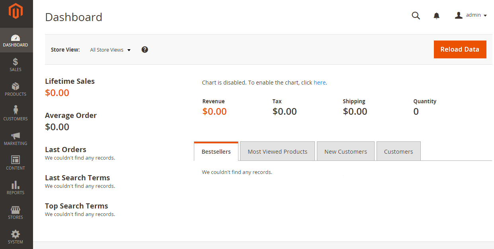

# 验证安装

在Web浏览器中转到店面。 例如，如果您的安装基础URL是`http://www.example.com`，请在浏览器的地址栏或位置栏中输入它。

下图显示了一个店面页面的示例。 如果它显示如下，则表示您的安装成功！

## 验证店面（无示例数据）

在Web浏览器中转到店面。 例如，如果您的安装基础URL是`http://www.example.com`，请在浏览器的地址栏或位置栏中输入它。

下图显示了一个店面页面的示例。 如果它显示如下，则表示您的安装成功！

如果页面显示`404 (Not Found)`错误或不显示样式，请参阅[疑难解答](https://support.magento.com/hc/en-us/articles/360032994352)。

## 验证管理员

在Web浏览器中转到“管理员”。 例如，如果您的安装基础URL是`http://www.example.com`，管理员URI是`admin_au1nT`，请在浏览器的地址栏或位置栏中输入`http://www.example.com/admin_au1nT`。

（`backend-frontname`安装参数的值指定了管理员URI。）

出现提示时，以管理员身份登录。

下图显示了一个管理页面示例。 如果它显示如下，则表示您的安装成功！

如果页面不显示样式，请参阅[疑难解答](https://support.magento.com/hc/en-us/articles/360032994352)。

如果出现与以下内容类似的404（未找到）错误，请参阅在浏览器](https://support.magento.com/hc/en-us/articles/360033117152)中访问Adobe Commerce时出现[PHP版本错误或404。

`The requested URL /magento2index.php/admin/admin/dashboard/index/key/0c81957145a968b697c32a846598dc2e/ was not found on this server.`
