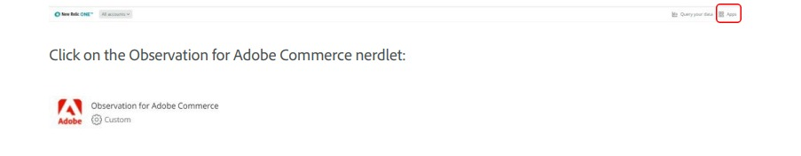

# 访问[!DNL Observation for Adobe Commerce] Nerdlet

要使用[!DNL New Relic Observation for Adobe Commerce] Nerdlet，请确保您有权访问[!DNL New Relic]。

[New Relic帐户管理](https://experienceleague.adobe.com/en/docs/commerce-on-cloud/user-guide/monitor/new-relic/account-management)

然后，从[!DNL New Relic]主页中，选择“应用程序”菜单项。

