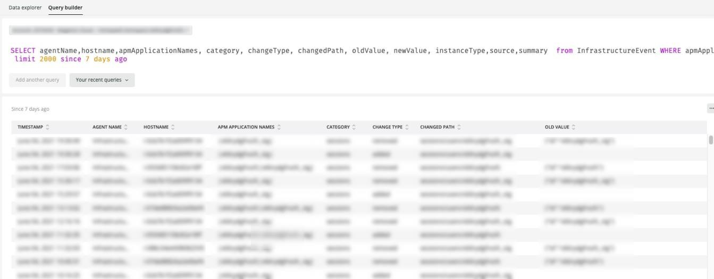

# [!UICONTROL Alerts]选项卡

[!UICONTROL Alerts]选项卡提供一系列警报，包括打开和关闭严重警报。

## [!UICONTROL Open Alert Details]

**[!UICONTROL Open Alert Details]**&#x200B;帧显示选定时间范围内未解决的严重警报的计数。 警报将包括Adobe创建的警报以及合作伙伴或商家创建的任何警报。

## [!UICONTROL Closed Critical Alerts]

**[!UICONTROL Closed Critical Alerts]**&#x200B;帧显示选定时间范围内已关闭关键警报的计数。 警报将包括Adobe创建的警报以及合作伙伴或商家创建的任何警报。

## [!UICONTROL Critical Alert Details]

**[!UICONTROL Critical Alert Details]**&#x200B;帧显示选定时间范围内关键警报详细信息的计数，包括时间戳、条件名称以及警报事件是打开还是关闭。

## [!UICONTROL Infrastructure Alert Details]

**[!UICONTROL Infrastructure Alert Details]**&#x200B;帧显示所选时间范围内的应用程序、主机和其他基础架构事件。
