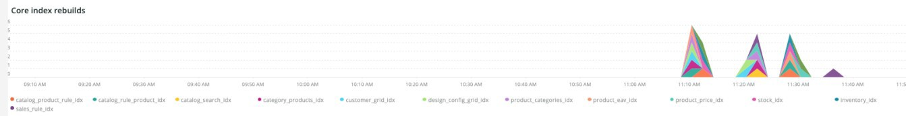
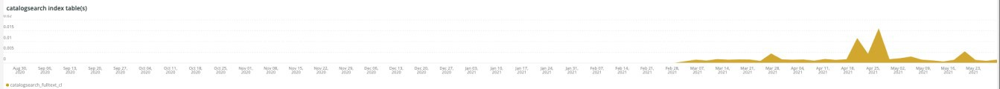
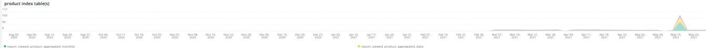

# [!UICONTROL Indexing]选项卡

**[!UICONTROL Indexing]**&#x200B;选项卡尝试解释索引问题并确定潜在原因。

## [!UICONTROL Core index invalidated]

**[!UICONTROL Core index invalidated]**&#x200B;框架查看选定时间范围内的索引失效。 如果索引与其他资源密集型[!DNL crons]同时发生，则会给站点资源带来沉重的负载。

* `%Catalog Product Rule indexer has been invalidated%`)，作为`catalog_product_rule_idx_reset`
* `%Catalog Rule Product indexer has been invalidated%`)，作为`catalog_rule_product_idx_reset`
* `%Catalog Search indexer has been invalidated%`)，作为`catalog_search_idx_reset`
* `%Category Products indexer has been invalidated%`)，作为`category_products_idx_reset`
* `%Customer Grid indexer has been invalidated%`)，作为`customer_grid_idx_reset`
* `%Design Config Grid indexer has been invalidated%`)，作为`design_config_grid_idx_`
* `%Product Categories indexer has been invalidated%`)，作为`product_categories_idx_reset`
* `%Product EAV indexer has been invalidated%`)，作为`product_eav_idx_reset`
* `%Product Price indexer has been invalidated%`)，作为`product_price_idx_reset`
* `%Stock indexer has been invalidated%`)，作为`stock_idx_reset`
* `%Inventory indexer has been invalidated%`)，作为`inventory_idx_reset`
* `%Inventory indexer has been invalidated%`)，作为`inventory_idx_reset`
* `%Sales Rule indexer has been invalidated%`)，作为`sales_rule_idx_reset`

## [!UICONTROL Core index rebuilds]

**[!UICONTROL Core index rebuilds]**&#x200B;框架查看选定时间范围内的核心索引重建。 以下是从日志中解析的字符串，用于指示索引重建已完成。

* `%Catalog Product Rule index has been rebuilt%`)，作为`catalog_product_rule_idx`
* `%Catalog Rule Product index has been rebuilt%`)，作为`catalog_rule_product_idx`
* `%Catalog Search index has been rebuilt%`)，作为`catalog_search_idx`
* `%Category Products index has been rebuilt successfully%`)，作为`category_products_idx`
* `%Customer Grid index has been rebuilt%`)，作为`customer_grid_idx`
* `%Design Config Grid index has been rebuilt%`)，作为`design_config_grid_idx`
* `%Product Categories index has been rebuilt%`)，作为`product_categories_idx`
* `%Product EAV index has been rebuilt%`)，作为`product_eav_idx`
* `%Product Price index has been rebuilt%`)，作为`product_price_idx`
* `%Stock index has been rebuilt%`)，作为`stock_idx`
* `%Inventory index has been rebuilt successfully%`)，作为`inventory_idx`
* `%Product/Target Rule index has been rebuilt successfully%`)，作为`prod_target_rule_idx`
* `%Sales Rule index has been rebuilt successfully%`)，作为`sales_rule_idx`

## [!UICONTROL catalogsearch index table(s)]

**[!UICONTROL catalogsearch index table(s)]**&#x200B;框架查看选定时间范围内的目录搜索索引表。 此查询正在查看对表名称中具有`%catalogsearch%`的表执行的任何数据存储操作的持续时间。

## [!UICONTROL product index table(s)]

**[!UICONTROL product index table(s)]**&#x200B;框架查看选定时间范围内的产品索引表。 此查询正在查看对表名称中具有`%product%`的表执行的任何数据存储操作的持续时间。
