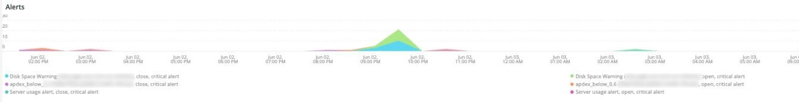
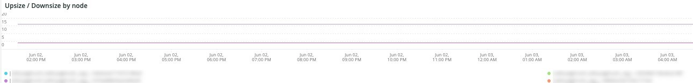

# [!DNL QuickView]选项卡

**[!UICONTROL QuickView]**&#x200B;选项卡说明了您可能会看到的不同警报类型，包括磁盘空间不足和服务器使用率较低的警报类型。 还描述了所述标签的帧。

## [!UICONTROL Alerts]

**[!UICONTROL Alerts]**&#x200B;帧显示不同的警报，包括选定时间范围内的磁盘空间警告和服务器使用情况警报。 此框架查看选定时间范围内的数据库表操作，包括`SELECT`、`DELETE`和`UPDATE`。

## [!UICONTROL Upsize / Downsize by node]

**[!UICONTROL Upsize / Downsize by node]**&#x200B;帧按节点显示选定时间范围内的放大和缩小情况。 用于评估所选时段内集群大小是否发生变化。

## [!UICONTROL CPU Utilization]

**[!UICONTROL CPU Utilization]**&#x200B;帧显示所选时间范围内按节点列出的CPU利用率。
