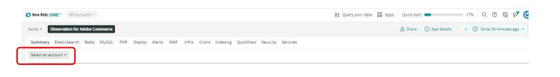
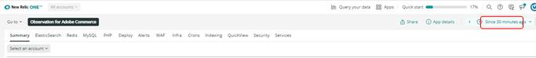

# 选择帐户和时间范围：

当您单击[!UICONTROL Observation for Adobe Commerce]图标时，[!DNL Observation for Adobe Commerce] Nerdlet将会打开。

1. 单击&#x200B;**选择帐户**&#x200B;下拉列表。 如果您看不到&#x200B;**选择帐户**&#x200B;下拉列表，则可能没有访问权限。 单击[此处](https://adobe.sharepoint.com/sites/MG/it/IT%20Services%20Wiki/Requesting%20access%20to%20Magento%20Commerce%20New%20Relic.aspx)请求访问权限。

   

1. 您可以粘贴project_id，键入[!DNL New Relic]帐号或帐户名，或者浏览帐户列表。

   

1. 单击带有时钟图标的&#x200B;**浅蓝色**（向Nerdlet窗口的右上角）下拉菜单。

   

1. 您应该设置票证日期时间之前的时间，以查看是否存在任何以前的事件/数据。 您可以使用左侧的预设时间范围，或通过选择&#x200B;**设置自定义**&#x200B;来设置自定义时间范围。
